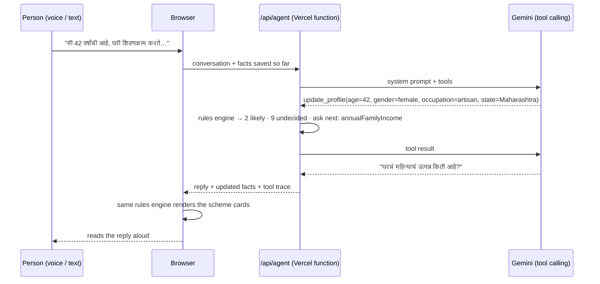
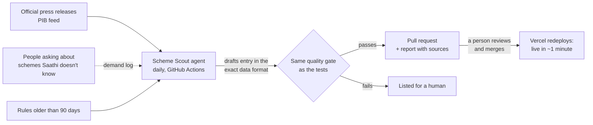

# Yojana Saathi · योजना साथी

**Speak in Marathi, Hindi or English, and find the government schemes meant for you.**

Yojana Saathi is a voice-first AI agent for people who find government paperwork hard: homemakers, farmers, street vendors, artisans, daily-wage workers and elderly people. You tell it about your life in your own words. It asks a few simple questions, works out which schemes you are likely eligible for, and gives you the documents to carry and where to apply, ready to share on WhatsApp.

**Live:** _deploy URL here_ · No login, no Aadhaar, no OTP.

## Why this exists

India runs hundreds of welfare schemes, and the people they are written for are the least likely to find them. The rules sit across a dozen portals, mostly in English. Finding out usually means paying an agent or making several trips to an office. One missing document sends you back.

Y Combinator's Winter 2027 Request for Startups names the same problem in the US (["Plaid for Government Benefits"](https://www.ycombinator.com/rfs)): *"People get rejected over a missing document."* It predicts that AI agents will handle enrollment. In India the gap is wider, and the user often can't type, so the agent has to listen, speak and keep things simple.

## What it does

- **Talk, don't fill forms.** Tap the mic and speak Marathi, Hindi or English using the browser's built-in speech recognition. Replies are read aloud.
- **Asks only what matters.** After each answer, the agent asks the one question that settles the most undecided schemes. A tailor never gets asked about farm land.
- **Explains its eligibility answers.** Every scheme card shows *Likely eligible*, *Need a little more info* (and which fact is missing) or *Not for you right now*.
- **Gives a document checklist** for each scheme, says where to apply (Setu Kendra / CSC, bank, post office, gas agency) and links the official site.
- **One-tap WhatsApp share**, so a family member or the Setu Kendra operator gets the whole list.
- **Shows how it decided.** Each reply has a "What Saathi checked" trace listing the tool calls the agent made.

## How the agent works



**The LLM never decides eligibility.** It does three jobs: understanding everyday speech ("my husband passed away" means `maritalStatus: widowed`, "12 thousand a month" means `annualFamilyIncome: 144000`), choosing how to word the next question, and replying in the person's language. Eligibility comes from a small deterministic rules engine ([`lib/engine.js`](lib/engine.js)) over data compiled from official scheme pages ([`lib/schemes.js`](lib/schemes.js)). The browser runs the same engine to draw the cards, so what the agent says and what the screen shows can't disagree.

| Tool | What it does |
|---|---|
| `update_profile` | Saves the facts the person stated (each one validated against a fixed schema), re-runs the rules, and returns the likely schemes plus the facts to ask about next |
| `get_scheme_details` | Returns the benefit, documents, how to apply and caveats for one scheme, in the person's language |

### Design decisions

- **Three-valued rules.** Each condition passes, fails or is *unknown*. If any rule fails, the scheme is ruled out. If none fail but some are unknown, it is undecided. The missing facts are counted across all undecided schemes, and that count picks the next question.
- **Validation at the trust boundary.** Tool arguments from the model and facts stored in the browser both go through `clean()`. Unknown fields, wrong types and out-of-range values are dropped before they reach the rules.
- **Zero dependencies, no build step.** It is plain HTML, CSS and ES modules plus one serverless function that calls the Gemini REST API with `fetch`. It loads quickly on a cheap Android phone on a slow connection.
- **Privacy by default.** There are no accounts and no database. The conversation stays in the browser's local storage. The agent is told never to ask for Aadhaar, bank account numbers, OTPs or PINs, and to warn people who offer them.
- **Honest wording.** It says "likely eligible", never "you will get". Each scheme links the page its rules came from, and the footer says this is not a government site.

## Schemes covered (15)

| Scheme | Level | Benefit | Rules from |
|---|---|---|---|
| PM-KISAN | Central | ₹6,000 a year in 3 payments of ₹2,000, straight to your bank account | [source](https://pmkisan.gov.in/) |
| PM Vishwakarma | Central | ₹15,000 toolkit, ₹500 a day during training, and loan of ₹1 lakh then ₹2 lakh at 5% interest | [source](https://pmvishwakarma.gov.in/) |
| PM SVANidhi | Central | Loan without guarantee: ₹15,000, then ₹25,000, then ₹50,000 as you repay on time | [source](https://pmsvanidhi.mohua.gov.in/) |
| e-Shram Card | Central | Free card with ₹2 lakh accident cover (₹1 lakh for partial disability) and a link to other worker schemes | [source](https://eshram.gov.in/) |
| PM Shram Yogi Maan-dhan (PM-SYM) | Central | ₹3,000 pension every month after age 60; government adds equal money to what you pay | [source](https://maandhan.in/) |
| Atal Pension Yojana | Central | Fixed pension of ₹1,000 to ₹5,000 a month after age 60, as per what you choose | [source](https://www.myscheme.gov.in/schemes/apy) |
| PM Jeevan Jyoti Bima Yojana (PMJJBY) | Central | ₹2 lakh life insurance for ₹436 a year; paid to family on death from any cause | [source](https://jansuraksha.gov.in/) |
| PM Suraksha Bima Yojana (PMSBY) | Central | ₹2 lakh accident insurance for just ₹20 a year (₹1 lakh for partial disability) | [source](https://jansuraksha.gov.in/) |
| Ayushman Bharat PM-JAY (Mahatma Phule Jan Arogya Yojana in Maharashtra) | Central | Free hospital treatment up to ₹5 lakh per family per year; everyone aged 70+ gets it, whatever the income | [source](https://www.myscheme.gov.in/schemes/ab-pmjay) |
| PM Ujjwala Yojana | Central | Free LPG gas connection for a poor household, with a ₹300 subsidy on each cylinder refill (up to 9 a year) | [source](https://www.pmuy.gov.in/) |
| Sukanya Samriddhi Yojana | Central | Savings account for your girl child with 8.2% interest (rate reviewed every 3 months), from ₹250 up to ₹1.5 lakh a year | [source](https://www.myscheme.gov.in/schemes/ssy) |
| PM Mudra Yojana | Central | Business loan without guarantee: up to ₹50,000 (Shishu), ₹5 lakh (Kishor), ₹10 lakh (Tarun), ₹20 lakh (Tarun Plus) | [source](https://static.pib.gov.in/WriteReadData/specificdocs/documents/2024/oct/doc20241029426401.pdf) |
| Mukhyamantri Majhi Ladki Bahin Yojana | Maharashtra | ₹1,500 every month in your bank account (₹18,000 a year) | [source](https://citizennest.com/guide/majhi-ladki-bahin-yojana-maharashtra) |
| Sanjay Gandhi Niradhar Anudan Yojana | Maharashtra | ₹2,500 every month for helpless people (raised from ₹1,500 from October 2025) | [source](https://gadchiroli.gov.in/sanjay-gandhi-yojana/) |
| Shravanbal Seva Rajya Nivruttivetan Yojana | Maharashtra | ₹2,500 pension every month for poor senior citizens aged 65+ (raised from ₹1,500 from October 2025) | [source](https://gadchiroli.gov.in/sanjay-gandhi-yojana/) |

The data was compiled on 7 Nov 2026. Some criteria are approximated, and each card's note says where: for example, "poor household" lists are approximated by a BPL / yellow ration card. Two Maharashtra pension amounts come from news reports of a 2025 cabinet decision. **Always confirm at the office before applying.**

## Keeping the rules current: a second agent, with a human in the loop

Government schemes change all the time. New ones are announced, amounts go up, and rules get tightened. Saathi keeps up in three layers:



1. **Scheme Scout** ([`scout/scout.mjs`](scout/scout.mjs)) runs every morning on GitHub Actions. It reads new press releases from the Press Information Bureau and filters them for welfare news. For each one, Gemini decides whether it adds a new scheme or changes an existing one, and if so drafts the entry **in the exact data format the app uses**, in all three languages. Every draft must pass the same `problems()` check the test suite uses. Drafts that fail are listed for a human, never published.
2. **Re-checking old rules.** Every scheme has a `checked` date. After 90 days the card warns *"rules may have changed"*, and the Scout re-reads that scheme's official source page to confirm it or propose a correction.
3. **Unknown schemes in chat.** If someone asks about a scheme Saathi doesn't know ("what about the new XYZ yojana?"), the agent calls `scheme_not_in_list`. It says plainly that the scheme isn't in its checked list, gives the official myScheme link and the Setu Kendra as next steps, and **does not describe the scheme from memory**. When Upstash is configured, it also counts the request, and the Scout watches for those scheme names first.

**A real run (7 Nov 2026).** On the live PIB feed, the Scout scanned 19 new press releases, correctly found none about welfare, and proposed nothing. Given the official notice of the August 2025 PM SVANidhi restructuring (`node scout/scout.mjs --release <url>`), it recognised an *update* to a scheme already in the database. It drafted the change in all three languages, adding the UPI-linked RuPay credit card and up to ₹1,600 digital cashback to the benefit line, passed the quality check, and wrote this report entry for the reviewer:

> ✏️ **Updated** `pm-svanidhi`: The Union Cabinet approved the restructuring of the PM SVANidhi scheme, increasing the first tranche loan up to ₹15,000, second tranche up to ₹25,000, extending the lending period to 31st March 2030, and adding UPI-linked RuPay Credit Card and digital cashback incentives.

When a model was overloaded (503) or out of free quota (429), the Scout moved to the next model. When every model failed, it listed the release for a human instead of guessing.

**Why a human still merges:** a wrong rule sends a poor person on a wasted trip and costs them a day's wages. The agent does the slow work (watching, reading, drafting in three languages, checking the format), and a person approves. It's the same review flow as code.

## Run it locally

```bash
cp .env.example .env.local   # add a free key from https://aistudio.google.com/apikey
node dev.mjs                 # → http://localhost:3000   (Node 20+, nothing to install)
node test.mjs                # rules engine + data integrity checks
```

Add `?lang=mr`, `?lang=hi` or `?lang=en` to the URL to open the app in that language.

## Deploy (free)

```bash
vercel                              # static files + api/agent.js as a serverless function
vercel env add GEMINI_API_KEY       # paste the key; then: vercel --prod
```

## Project layout

```
index.html, styles.css, app.js   UI: chat, voice, scheme cards, WhatsApp share (3 languages)
api/agent.js                     the agent loop: Gemini function calling, max 6 steps
lib/engine.js                    deterministic eligibility engine + fact schema (shared by browser and server)
lib/schemes.js                   15 schemes: rules, benefits, documents, how to apply, sources
scout/scout.mjs                  Scheme Scout: watches official releases, drafts + validates updates, re-checks stale rules
.github/workflows/scout.yml      runs the Scout daily at 07:00 IST and opens a pull request for review
test.mjs                         engine logic, input validation, data-quality gate, persona checks (runs in CI)
dev.mjs                          local server that mimics Vercel
```

Scout setup: add `GEMINI_API_KEY` as a repository secret, and allow Actions to create pull requests (Settings → Actions → General). Run it by hand from the Actions tab, or locally with `node scout/scout.mjs`. Optional: add the `UPSTASH_REDIS_REST_URL` and `UPSTASH_REDIS_REST_TOKEN` secrets (free tier) to both Vercel and Actions to turn on the demand log.

## Limits and next steps

- **Sources:** the Scout reads only the PIB feed today. Maharashtra's official orders (GRs) and myScheme are next. Some government sites block automated readers, so those schemes rely on the 90-day re-check flagging them for a human.
- **Coverage:** only central and Maharashtra schemes so far. Adding another state means adding data only, with no code changes.
- **Operator mode:** a version for Setu Kendra / CSC operators, who earn per application, that turns any operator into an expert (YC's ["$15-an-Hour Expert"](https://www.ycombinator.com/rfs)).
- **Abuse limits:** there is no per-IP rate limit yet, so the free-tier key's quota is the ceiling. The next step is Upstash or Vercel KV.

---

Not a government website and not legal advice. Built by [Yash](https://github.com/Yashgurav002). MIT License.
